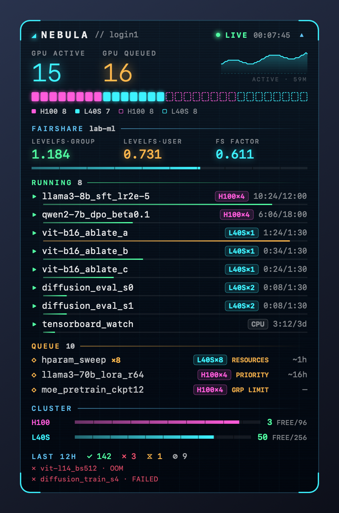

# SlurmHUD

A small native macOS HUD for your Slurm jobs. It sits on your desktop (or floats above your windows) and shows
how many GPUs you are using, what is queued and why, your fair-share LevelFS, and how many GPUs the cluster has free.

[中文说明](README.zh-CN.md)



- **Light.** AppKit + SwiftUI in a single Swift file. No Electron, no web view. About 35 MB of memory and ~0% CPU when idle.
- **One ssh call per refresh.** Every 60 s by default, about 11 KB of output. Nothing to install on the cluster.
- **Safe on MFA login nodes.** It reuses your SSH ControlMaster connection. After one failed login it never tries
  to authenticate again on its own, so a sleeping laptop can't get your IP banned.

## What it shows

| Section | Contents |
|---|---|
| GPU ACTIVE / QUEUED | GPUs held by your running jobs and requested by pending ones. One block per GPU, colored by type; dashed blocks are queued. A sparkline tracks the last hours. |
| FAIRSHARE | LevelFS of your account against other accounts, your own LevelFS within the account, and the FairShare factor (all from `sshare`). |
| RUNNING | Each job with GPU type × count, elapsed / time limit, and a progress bar that turns amber past 90%. |
| QUEUE | Pending reason (PRIORITY, RESOURCES, QOS LIMIT, …) and Slurm's estimated start. Collapsed job arrays are counted per task. |
| CLUSTER | Free / total GPUs per type, counting only nodes that can take new work (down, draining and unresponsive nodes are excluded). |
| LAST 12H | Completed, failed, timed-out and cancelled jobs, plus the most recent failures. |

The menu bar item shows the same at a glance: `▣ 15 ◇10` means 15 GPUs in use and 10 queued tasks.

## Requirements

- macOS 13 or later, and the Xcode Command Line Tools to build (`xcode-select --install`).
- A Slurm cluster you can reach with `ssh <alias>`. `squeue` is required. `sshare`, `sinfo` and `sacct` are optional:
  a section whose command fails is marked N/A (or STALE if older data exists) instead of showing zeros. Tested on Slurm 25.05.

## Install

```bash
git clone https://github.com/sunfly04/slurm-hud.git
cd slurm-hud
./build.sh run
```

This builds the app, signs it ad hoc, installs it to `~/Applications/SlurmHUD.app` and launches it.
On first launch the HUD shows **CONFIG ERROR**: click **EDIT**, set `host`, save, then click **RELOAD**.

## Configure

`~/.config/slurm-hud/config.json`:

```json
{
  "host": "mycluster",
  "label": "MYCLUSTER",
  "refreshSeconds": 60
}
```

| Key | Default | Meaning |
|---|---|---|
| `host` | (empty) | A `Host` alias from `~/.ssh/config` |
| `label` | host name | Title shown in the header |
| `refreshSeconds` | `60` | Polling interval, 10–3600 |
| `maxRows` | `8` | Rows shown per RUNNING / QUEUE section, 1–50 |
| `historyHours` | `12` | Window for the history line, 1–336 |
| `showCluster`, `showHistory` | `true` | Turning one off also skips its query on the cluster |
| `extraSSHOptions` | `[]` | Extra ssh arguments for every call, e.g. `["-o", "Port=2222"]` |

After editing, choose **Reload Config** from the menu bar item.

## SSH setup and MFA clusters

SlurmHUD runs `ssh` in `BatchMode`, so it can never prompt for a password. On clusters that need a password or MFA,
turn on connection sharing for the host:

```
Host mycluster
  HostName login.cluster.example.edu
  User alice
  ControlMaster auto
  ControlPath ~/.ssh/cm-%C
  ControlPersist 10m
```

Then log in once, either with `ssh mycluster` in a terminal or by clicking **RECONNECT** in the HUD. RECONNECT opens
Terminal, where you complete MFA, and leaves a master connection running in the background. Because the HUD polls it
regularly, the master stays up until the network drops (after sleep, for example). The HUD then shows
**AUTH REQUIRED** until you reconnect. If your config has no `ControlPath`, SlurmHUD uses `~/.ssh/slurmhud-%C`.

How it avoids lockouts:

- Before each refresh it checks the master socket locally (`ssh -O check`).
- When the master is up, the fetch also sets `ProxyCommand=/usr/bin/false`. If the socket vanishes mid-way,
  ssh fails on your Mac instead of falling back to a fresh login.
- Without a master it tries one direct login (fine for key-only clusters). If that login reaches the server and
  fails, the HUD stops connecting and only watches the local socket. Pure network errors back off up to 15 minutes.

## Using it

- Drag anywhere to move it. **▴ / ▾** switches to a one-line compact view.
- Right-click a job to copy its ID, its name or a `scancel` command.
- By default the HUD is pinned to the desktop, behind your windows like a widget. Show the desktop with Fn+F11, ⌘F3
  or a trackpad spread to see it. Choose **Float Above Windows** in the menu to keep it on top instead.
- The menu bar item also has show/hide, opacity, click-through, reconnect, edit/reload config and Launch at Login.

## How it works

Each refresh pipes one bash script over ssh (`bash -s`). It runs `squeue -u $USER`, `sshare`, `sinfo -N` and
`sacct -X`, strips column padding, counts history on the server and prints tagged sections that the app parses.
Times are requested as epochs (`SLURM_TIME_FORMAT=%s`), so time zones and DST don't matter. The first refresh uses a
login shell to find `SLURM_CONF` and the Slurm binaries, then caches them, so later refreshes skip your profile scripts.

Nothing leaves your Mac except that ssh connection to your own cluster. There is no telemetry.

## Development

```bash
./build.sh              # build and install for this Mac
./build.sh universal    # arm64 + x86_64, also writes build/SlurmHUD.zip
Tests/run.sh            # parser regression tests
```

The binary has a few flags for working without a cluster:

```bash
B=~/Applications/SlurmHUD.app/Contents/MacOS/SlurmHUD
$B --parse Tests/edge_cases.txt                     # print what the parser makes of a probe output
$B --demo docs/demo_probe.txt --render /tmp/hud.png # synthetic data, PNG of the HUD
SLURMHUD_CONFIG_DIR=/tmp/t1 $B                      # isolated config directory
```

[CLAUDE.md](CLAUDE.md) describes the architecture and the invariants that keep it safe and light.

## Related projects

Terminal UIs such as [turm](https://github.com/kabouzeid/turm), [slurm-avail](https://pypi.org/project/slurm-avail/)
and [slin](https://pypi.org/project/slin/) are great when you have a terminal open on the cluster.
[GPUBar](https://github.com/kyleok/gpubar) puts cluster GPU availability in the menu bar.

## License

[MIT](LICENSE)
