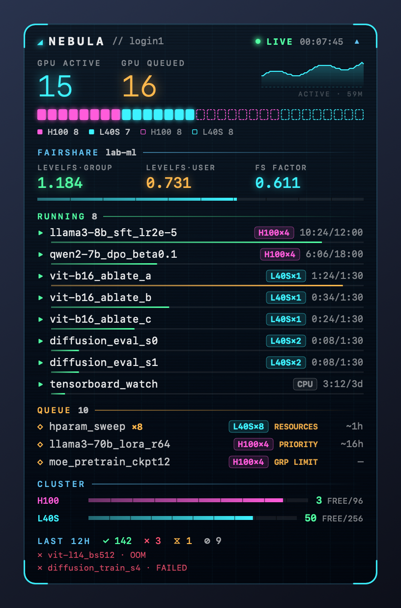
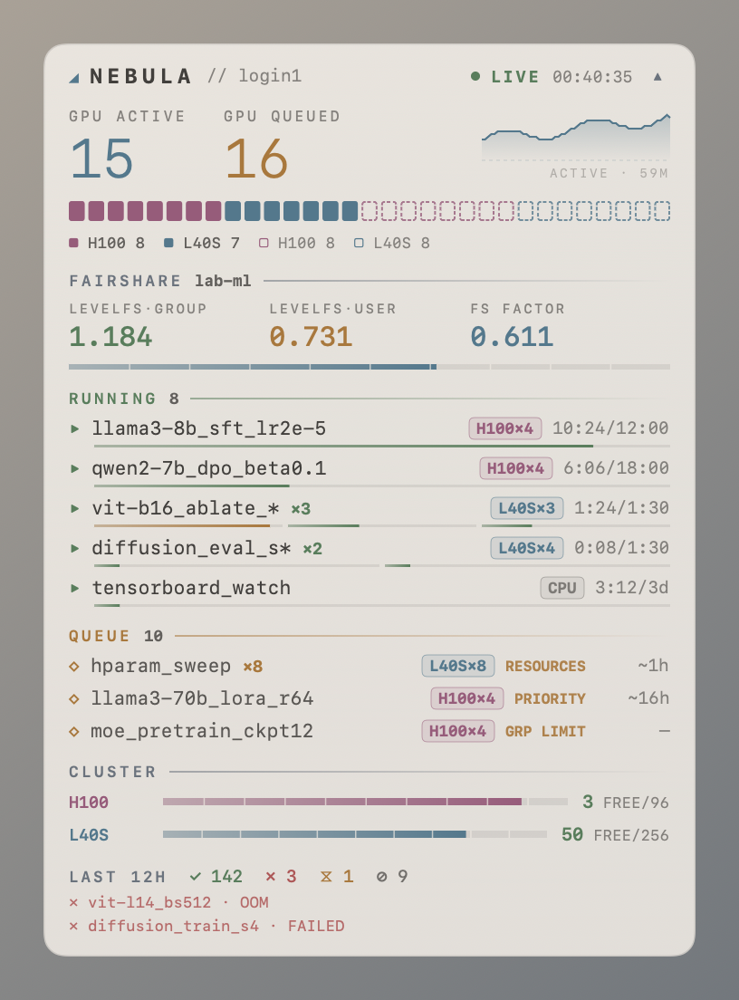

# SlurmHUD

[English](README.md) · 中文

一个原生的 macOS 桌面小看板，用来盯 Slurm 作业。它可以放在桌面上，也可以悬浮在所有窗口之上，显示你正在用几张卡、哪些作业在排队以及原因，也会显示你的 fair-share LevelFS 和集群剩余的空闲卡。

<p align="center">
  
  
</p>

- **轻量**：一个 Swift 文件，AppKit + SwiftUI，没有 Electron，也没有 WebView。内存约 35 MB，空闲时 CPU 接近 0。
- **每次刷新只走一次 ssh**：默认 60 秒一次，返回约 11 KB 数据，集群上什么都不用装。
- **对 MFA 登录节点安全**：复用你的 SSH ControlMaster 连接。一次登录失败之后就不会再自己去认证，所以笔记本睡眠醒来也不会把你的 IP 弄进封禁名单。
- **一眼看清**：同一组 sweep、同一批 seed 自动合并成一行，八个作业读起来就是三个实验。
- **安静**：低饱和度配色，跟随系统的浅色 / 深色外观。

## 显示内容

| 区块 | 内容 |
|---|---|
| GPU ACTIVE / QUEUED | 你的 running 作业占用、pending 作业申请的 GPU 数。每张卡一个方块，按型号着色，虚线框表示排队中。旁边的小折线图记录最近几小时的变化。 |
| FAIRSHARE | 你所在 account 相对其他 account 的 LevelFS、你在组内的 LevelFS，以及 FairShare 因子（都来自 `sshare`）。 |
| RUNNING | 每个作业（或[一组相似作业](#作业分组)）的 GPU 型号 × 数量、已运行时间 / 时限，以及进度条，超过 90% 会变色。 |
| QUEUE | 排队原因（PRIORITY、RESOURCES、QOS LIMIT 等）和 Slurm 估计的开始时间。合并显示的数组作业按任务数计数。 |
| CLUSTER | 每种卡的空闲数 / 总数，只统计能接新作业的节点（down、draining、不响应的节点不算）。 |
| LAST 12H | 最近 12 小时完成、失败、超时、取消的作业数，以及最近失败的几个作业。 |

菜单栏图标也会显示摘要：`▣ 15 ◇10` 表示正在用 15 张卡，有 10 个任务在排队。

## 环境要求

- macOS 13 及以上，编译需要 Xcode Command Line Tools（`xcode-select --install`）。
- 一个能用 `ssh <别名>` 登录的 Slurm 集群。`squeue` 是必需的。`sshare`、`sinfo`、`sacct` 可选，某条命令失败时对应区块会标 N/A（有旧数据时标 STALE），不会显示成 0。在 Slurm 25.05 上测试过。

## 安装

```bash
git clone https://github.com/sunfly04/slurm-hud.git
cd slurm-hud
./build.sh run
```

脚本会先编译并做 ad-hoc 签名，然后安装到 `~/Applications/SlurmHUD.app` 并启动。第一次启动会显示 **CONFIG ERROR**：点 **EDIT**，填好 `host` 保存，再点 **RELOAD**。

## 配置

配置文件在 `~/.config/slurm-hud/config.json`：

```json
{
  "host": "mycluster",
  "label": "MYCLUSTER",
  "refreshSeconds": 60
}
```

| 键 | 默认值 | 说明 |
|---|---|---|
| `host` | （空） | `~/.ssh/config` 里的 `Host` 别名 |
| `label` | host 名 | 标题栏显示的名字 |
| `refreshSeconds` | `60` | 刷新间隔，10–3600 秒 |
| `maxRows` | `8` | RUNNING / QUEUE 每节最多显示几行，1–50 |
| `historyHours` | `12` | 历史统计的时间窗口，1–336 小时 |
| `showCluster`、`showHistory` | `true` | 关掉后，集群上对应的查询也不再执行 |
| `extraSSHOptions` | `[]` | 每次 ssh 调用都会带上的额外参数，例如 `["-o", "Port=2222"]` |
| `groupJobs` | `true` | 相似的作业合并成一行，见[作业分组](#作业分组) |
| `groupRules` | `[]` | 自定义分组，优先于自动规则 |

改完后在菜单栏图标里点 **Reload Config**。

### 同时看多台服务器

加一个 `servers` 列表即可，每台服务器一个独立窗口。每一项都继承顶层的设置，自己写了的键会覆盖顶层：

```json
{
  "refreshSeconds": 60,
  "servers": [
    { "host": "cluster-a", "label": "A" },
    { "host": "cluster-b", "label": "B", "maxRows": 4 }
  ]
}
```

菜单栏图标会按配置顺序显示每台的状态（`▣ 18 ◇10 │ 4`），菜单里每台服务器有一个子菜单。
窗口位置、显示/隐藏、透明度、层级和紧凑模式都按服务器分别保存。每台服务器都要有自己的 ssh master，
**Reconnect SSH** 会为每个 host 各开一个 Terminal 窗口。

### 作业分组

属于同一组的作业在 RUNNING 和 QUEUE 里各占一行：

- **自动规则**：名字只差一个字段（一个数字，或末尾单个字母）的作业会合并，例如 `eval_s0`、`eval_s1` → `eval_s* ×2`，`ablate_a`、`ablate_b` → `ablate_* ×2`。同一个数组作业的任务也会合并。
  标签会保留所有相同的字段，比如 `run_d512_s3000_k2`、`run_d512_s3000_k3` → `run_d512_s3000_k* ×2`。
  差了两个字段的（`d512_s3000` 和 `d256_s7000`）算不同配置，分开显示；想把网格搜索合成一行，加一条自定义规则即可。
- **自定义规则**：`match` 是在作业名里搜索的正则，按顺序匹配，先命中的生效。`label` 可省略，默认取这些名字的公共部分。

```json
"groupRules": [
  { "match": "^(llama|qwen)", "label": "LLM finetunes" },
  { "match": "eval" }
]
```

合并后的一行显示作业数、整组的 GPU 数，以及每个作业一条细进度条。时间取最接近时限的那个作业，排队的组取最早的预计开始时间。悬停可看每个作业的明细，右键可复制全部作业 ID。想让每个作业单独占一行，设 `"groupJobs": false`。

## SSH 设置与 MFA 集群

SlurmHUD 用 `BatchMode` 运行 `ssh`，永远不会弹出密码提示。如果集群登录需要密码或 MFA，需要在 `~/.ssh/config` 里给这个 host 打开连接复用：

```
Host mycluster
  HostName login.cluster.example.edu
  User alice
  ControlMaster auto
  ControlPath ~/.ssh/cm-%C
  ControlPersist 10m
```

然后登录一次即可：在终端里 `ssh mycluster`，或者点 HUD 上的 **RECONNECT**。RECONNECT 会打开终端，你在里面完成 MFA，之后后台会留下一条常驻的 master 连接。HUD 会定期使用这条连接，所以它会一直保持，直到网络断开（比如电脑睡眠之后），这时 HUD 显示 **AUTH REQUIRED**，重新连一次就好。如果你的配置里没有 `ControlPath`，SlurmHUD 会使用 `~/.ssh/slurmhud-%C`。

为了不被登录节点封禁，它做了这几件事：

- 每次刷新前先在本地检查 master socket（`ssh -O check`）。
- master 在线时，拉数据的命令会额外加上 `ProxyCommand=/usr/bin/false`。如果 socket 中途消失，ssh 会直接在本机失败，而不是退回去重新登录。
- 没有 master 时只尝试一次直接登录（适合只用密钥的集群）。如果这次登录到达了服务器却失败了，HUD 就不再发起连接，只观察本地 socket。纯网络错误会按指数退避重试，最长间隔 15 分钟。

## 使用

- 拖动面板任意位置可以移动。点 **▴ / ▾** 切换成一行的精简模式。
- 鼠标悬停在一行上可以看到作业 ID、分区和节点。右键可以复制作业 ID、作业名或者 `scancel` 命令。
- 默认钉在桌面上，位于所有窗口下面，效果像桌面小组件。用 Fn+F11、⌘F3 或触控板张开手势回到桌面就能看到。想让它一直在最上层，就在菜单里选 **Float Above Windows**。
- 菜单栏图标里还有显示/隐藏、透明度、点击穿透、重连、编辑/重载配置和开机启动。

## 工作原理

每次刷新通过 ssh 把一段 bash 脚本传过去执行（`bash -s`）。脚本依次运行 `squeue -u $USER`、`sshare`、`sinfo -N` 和 `sacct -X`，去掉列对齐用的空格，在服务器上统计历史作业，再输出带标记的分段结果，由 app 解析。时间统一要求输出成 epoch（`SLURM_TIME_FORMAT=%s`），所以时区和夏令时都不会影响结果。第一次刷新用登录 shell 找到 `SLURM_CONF` 和 Slurm 命令所在目录并缓存下来，之后的刷新就不再执行你的 profile 脚本。

除了连到你自己集群的这条 ssh 连接，没有任何数据离开你的 Mac，也没有遥测。

## 开发

```bash
./build.sh              # 为本机编译并安装
./build.sh universal    # arm64 + x86_64，同时生成 build/SlurmHUD.zip
Tests/run.sh            # 解析器回归测试
```

不连集群也能调试，可执行文件支持这几个参数：

```bash
B=~/Applications/SlurmHUD.app/Contents/MacOS/SlurmHUD
$B --parse Tests/edge_cases.txt                     # 打印解析器对一段探测输出的解析结果
$B --demo docs/demo_probe.txt --render /tmp/hud.png # 用虚构数据渲染 HUD 的 PNG（可加 --light 或 --dark）
SLURMHUD_CONFIG_DIR=/tmp/t1 $B                      # 使用单独的配置目录
```

架构说明和必须遵守的约束见 [CLAUDE.md](CLAUDE.md)。

## 相关项目

如果你习惯在集群上开着终端，[turm](https://github.com/kabouzeid/turm)、[slurm-avail](https://pypi.org/project/slurm-avail/)、[slin](https://pypi.org/project/slin/) 这些终端界面都很好用。[GPUBar](https://github.com/kyleok/gpubar) 则把集群的 GPU 余量放进了菜单栏。

## 许可证

[MIT](LICENSE)
